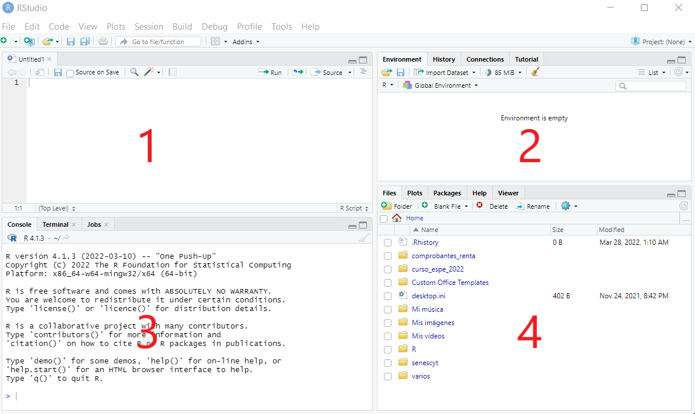
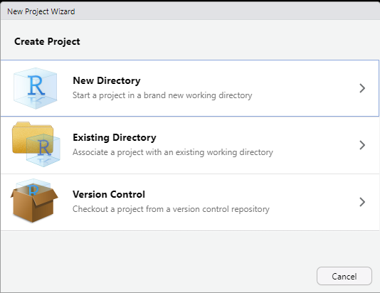
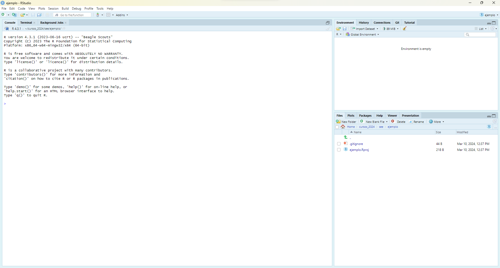
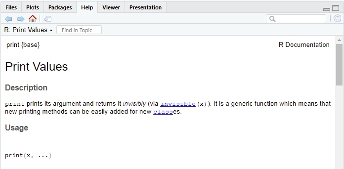
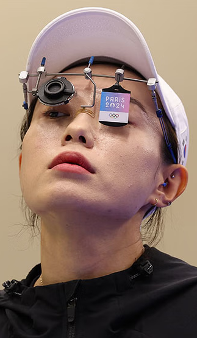
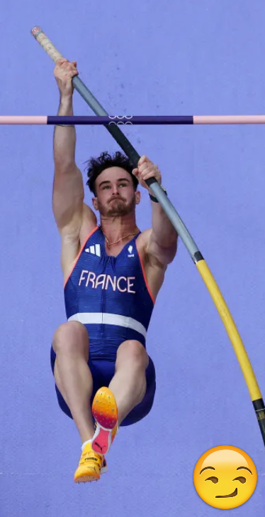

## {}

::: columns
::: {.column width="37.5%"}
{style="margin-left:-40px"}
:::

::: {.column width="60%"}
::: {.title data-id="title"}
Módulo 1: Generalidades e introducción a R
:::

Mauricio Moreno, PhD

Domingo 15 de noviembre de 2026
:::
:::

{.image-left}

## Acerca del curso {.smaller}

::: incremental
-   Cuatro domingos, de 9H00 a 12H00: **15, 22 y 29 de noviembre, y 6 de diciembre**.
-   Todo el material está en la [página web del curso](../index.html){target="_blank"}: estas diapositivas, ejercicios interactivos, autoevaluaciones y recursos.
-   Los ejercicios corren **en el navegador**: puedes practicar aunque todavía no tengas R instalado.
-   Evaluación: **40%** ejercicios en clase y **60%** examen virtual. Con **7/10** obtienes el certificado de aprobación.
-   Preguntas fuera de clase: **mmorenozambrano\@gmail.com**
:::

## Hoy

1.  R, RStudio y los proyectos de R
2.  Reglas de sintaxis, tipos de datos y operadores
3.  Objetos: vectores, factores, tablas de datos y listas
4.  Paquetes e importación de datos
5.  Estadísticos descriptivos

. . .

Entre cada bloque, **ejercicios** en la página del curso.

# R y RStudio

## ¿Por qué R? {.smaller}

::: columns
::: {.column width="50%"}
{target="_blank"}](images/use.jpg){fig-align="center"}
:::

::: {.column width="50%"}
::: incremental
-   Es **gratuito** y de código abierto.
-   Tiene más de 20 000 paquetes para casi cualquier análisis.
-   Es el estándar en muchas áreas de la biología, la agronomía y la salud.
-   Todo queda escrito en un **script**: el análisis se puede repetir, revisar y compartir.
-   Una comunidad enorme, también en español.
:::
:::
:::

## Instalación de R y RStudio {.smaller}

Se instalan **en este orden**:

1.  **R**, desde [CRAN](https://cran.r-project.org/){target="_blank"}: es el lenguaje, el que hace los cálculos.
2.  **RStudio Desktop**, desde [Posit](https://posit.co/download/rstudio-desktop/){target="_blank"}: es el entorno donde escribimos y ejecutamos el código.

. . .

::: callout-tip
La guía paso a paso está en la sección [Recursos](../recursos.html#instalacion){target="_blank"} de la página del curso.
:::

## RStudio

{fig-align="center"}

## Los cuatro paneles {.smaller}

::: incremental
-   **Script** (arriba a la izquierda): donde escribimos el código que queremos guardar. `Ctrl + Enter` ejecuta la línea actual.
-   **Consola** (abajo a la izquierda): donde R ejecuta el código y muestra los resultados.
-   **Entorno** (arriba a la derecha): los objetos que hemos creado.
-   **Archivos, gráficos, paquetes y ayuda** (abajo a la derecha).
:::

# Proyectos de R

## ¿Por qué un proyecto? {.smaller}

::: incremental
-   Un **proyecto de R** es una carpeta con un archivo `.Rproj`.
-   Al abrirlo, RStudio fija esa carpeta como **carpeta de trabajo**.
-   Así podemos usar **rutas relativas**: `"datos/ranas.csv"` en lugar de `"C:/Users/Mauricio/Documentos/curso/datos/ranas.csv"`.
-   El mismo código funciona en tu computador, en el mío y en el de un colega.
:::

## Creando un proyecto {.smaller}

::: columns
::: {.column width="40%"}
{fig-align="center"}
:::

::: {.column width="60%"}
1.  *File* (Archivo) → *New Project...* (Nuevo proyecto...)
2.  *New Directory* (Nuevo directorio)
3.  *New Project* (Nuevo proyecto)
4.  Elegimos el nombre de la carpeta y dónde crearla.
:::
:::

## Creando un proyecto {visibility="uncounted"}

{fig-align="center"}

## Una estructura sencilla {.smaller}

::: columns
::: {.column width="45%"}
```
curso_R/
├── curso_R.Rproj
├── datos/
│   └── ranas.csv
├── scripts/
│   └── modulo_1.R
└── resultados/
```
:::

::: {.column width="55%"}
::: incremental
-   `datos/`: los datos originales. **No se modifican a mano.**
-   `scripts/`: el código, un archivo por tarea o por sesión.
-   `resultados/`: tablas y gráficos que produce el código.
:::
:::
:::

# Sintaxis, tipos de datos y operadores

## Reglas generales {.smaller}

::: incremental
-   R distingue mayúsculas y minúsculas: `Tabla` y `tabla` son objetos distintos.
-   Asignamos con `<-` (también funciona `=`): `x <- 5`.
-   Los nombres no pueden empezar con un número ni tener espacios: mejor `masa_final` que `masa final`.
-   Todo lo que va después de `#` es un **comentario**: R no lo ejecuta.
-   Evitemos nombres que ya usa R, como `T`, `F`, `c` o `mean`.
:::

. . .

```{r}
# Longitud de un renacuajo, en mm
longitud <- 19.7
longitud * 2
```

## Tipos de datos

| Tipo | Ejemplo | Para qué |
|:--|:--|:--|
| `numeric` | `19.7`, `-3` | mediciones |
| `integer` | `5L` | conteos |
| `character` | `"Hi"`, `"control"` | texto |
| `logical` | `TRUE`, `FALSE` | sí o no |
| `factor` | `factor(c("C", "L"))` | grupos o tratamientos |

. . .

```{r}
class(19.7)
class("control")
```

## Operadores {.smaller}

::: columns
::: {.column width="33%"}
**Aritméticos**

`+  -  *  /  ^`

```{r}
2^10
(19.7 - 19.4) / 19.4 * 100
```
:::

::: {.column width="33%"}
**De comparación**

`==  !=  <  >  <=  >=`

```{r}
5 == 5
5 != 3
```
:::

::: {.column width="33%"}
**Lógicos**

`&` (y), `|` (o), `!` (no)

```{r}
(5 > 3) & (2 > 4)
(5 > 3) | (2 > 4)
```
:::
:::

# Objetos

## Vectores {.smaller}

Un vector guarda varios valores **del mismo tipo**. Se crea con `c()`.

```{r}
masas <- c(0.42, 0.38, 0.41, 0.38, 0.49)
length(masas)
masas[2]
masas[masas > 0.4]
```

. . .

Las operaciones se aplican a **todos** los elementos:

```{r}
masas * 1000
```

## Factores {.smaller}

Un factor es un vector de grupos, con **niveles**.

```{r}
depredador <- factor(c("C", "L", "NL", "C", "L"))
depredador
levels(depredador)
table(depredador)
```

. . .

Los tratamientos de un experimento casi siempre son factores. Lo usaremos mucho en el ANOVA.

## Tablas de datos {.smaller}

Un `data.frame` es una tabla: cada columna es un vector, y todas tienen el mismo largo.

```{r}
tanques <- data.frame(
  tanque = c(1, 2, 3),
  depredador = c("C", "L", "NL"),
  masa = c(0.38, 0.51, 0.40)
)
tanques
```

. . .

```{r}
tanques$masa          # una columna, con $
tanques[2, ]          # una fila: [fila, columna]
tanques[3, "masa"]    # un valor
```

## Listas {.smaller}

Una lista guarda objetos **de cualquier tipo**, incluso otras tablas.

```{r}
experimento <- list(nombre = "ranas", tanques = 78, tabla = tanques)
experimento$tanques
```

. . .

Muchos resultados de R, como los de `t.test()` o `aov()`, son listas.

## {}

::: columns
::: {.column width="37.5%"}
:::

::: {.column width="60%"}
::: {.title data-id="title"}
[Ejercicios, Parte 1](../ejercicios-1.html#parte-1){target="_blank"}
:::

::: {.timer #Timer1 seconds=900 starton=interaction}
:::
:::
:::

{.image-left}

# Paquetes e importación de datos

## Paquetes {.smaller}

::: incremental
-   Un **paquete** agrega funciones a R. Se descargan de [CRAN](https://cran.r-project.org/){target="_blank"}.
-   Se **instalan una sola vez** en tu computador:
:::

. . .

```{r}
#| eval: false
install.packages("readxl")
```

. . .

::: incremental
-   Se **cargan en cada sesión** en que los uses:
:::

. . .

```{r}
#| eval: false
library(readxl)
```

## Ayuda en R {.smaller}

::: columns
::: {.column width="45%"}
```{r}
#| eval: false
?mean
help(sd)
example(mean)
```

::: incremental
-   La ayuda explica los **argumentos** de cada función y trae ejemplos al final.
-   Un mensaje de error copiado en un buscador casi siempre tiene respuesta.
:::
:::

::: {.column width="55%"}
{fig-align="center"}
:::
:::

## Importar un archivo csv {.smaller}

En tu proyecto, con el archivo en la carpeta `datos/`:

```{r}
ranas <- read.csv("datos/ranas.csv")
```

. . .

Lo primero, siempre: revisar lo que importamos.

```{r}
str(ranas)
```

## Importar un archivo de Excel {.smaller}

```{r}
#| eval: false
library(readxl)
ranas <- read_excel("datos/ranas.xlsx", sheet = 1)
```

. . .

::: callout-tip
## Antes de importar

-   Una fila por observación y una columna por variable.
-   Nombres de columna cortos, sin espacios ni tildes.
-   Sin celdas combinadas, colores ni totales al final.
:::

## Los datos del curso {.smaller}

`ranas.csv`: 78 tanques de un experimento con renacuajos (datos del Prof. Justin C. Touchon).

| Variable | Qué es |
|:--|:--|
| `Pred` | depredador: `C` control, `NL` no letal, `L` letal |
| `Res` | recursos alimenticios: `Hi` altos, `Lo` bajos |
| `Hatch` | momento de eclosión: `E` temprano, `L` tardío |
| `SVL.final` | longitud hocico-cloaca al salir del agua (mm) |
| `Mass.final` | masa al salir del agua (g) |
| `Age.FromEmergence` | edad al salir del agua (días) |
| `Resorb.days` | días para reabsorber la cola |

## {}

::: columns
::: {.column width="37.5%"}
:::

::: {.column width="60%"}
::: {.title data-id="title"}
[Ejercicios, Parte 2](../ejercicios-1.html#parte-2){target="_blank"}
:::

::: {.timer #Timer2 seconds=600 starton=interaction}
:::
:::
:::

{.image-left}

# Estadísticos descriptivos

## Tendencia central {.smaller}

```{r}
mean(ranas$SVL.final)
median(ranas$SVL.final)
```

. . .

::: incremental
-   La **media** es sensible a los valores extremos; la **mediana**, no.
-   Si la media es bastante mayor que la mediana, hay una cola de valores altos.
:::

. . .

```{r}
mean(ranas$Age.FromEmergence)
median(ranas$Age.FromEmergence)
```

## Dispersión {.smaller}

$$
s = \sqrt{\frac{\sum_{i=1}^{n}(x_i - \bar{x})^2}{n - 1}}
$$

```{r}
sd(ranas$SVL.final)
var(ranas$SVL.final)
range(ranas$SVL.final)
quantile(ranas$SVL.final)
```

## Todo a la vez {.smaller}

```{r}
summary(ranas$SVL.final)
```

. . .

```{r}
boxplot(ranas$SVL.final, horizontal = TRUE, xlab = "Longitud final (mm)")
```

## Resumir por grupos {.smaller}

```{r}
tapply(ranas$SVL.final, ranas$Pred, mean)
```

. . .

```{r}
aggregate(SVL.final ~ Pred, data = ranas, FUN = mean)
```

. . .

```{r}
#| fig-height: 4
boxplot(SVL.final ~ Pred, data = ranas, xlab = "Depredador", ylab = "Longitud final (mm)")
```

## Variables categóricas {.smaller}

```{r}
table(ranas$Pred)
prop.table(table(ranas$Pred))
table(ranas$Pred, ranas$Res)
```

## Otras formas de calcular estadísticos descriptivos

::: incremental
La forma más sencilla de calcular los estadísticos descriptivos de una tabla de datos es usando la función base `summary`
:::

. . .

```{r echo=T, eval=T, error=T}
summary(ranas)
```

## Estadísticos descriptivos {.smaller visibility="uncounted"}

::: incremental
-   Usar la función `summary` resulta útil para hacer chequeos sobre la marcha.

-   Para obtener una tabla de estadísticos descriptivos más útil en términos de presentación de resultados, usaremos básicamente dos funciones del paquete `{tidycomm}`

    -   `describe`: para generar tablas de estadísticos descriptivos de variables cuantitativas

    -   `describe_cat`: para tablas de estadísticos descriptivos de variables categóricas
:::

. . .

```{r echo=T, eval=T, error=T}
library(tidycomm)
describe(ranas)
```

. . .

```{r echo=T, eval=T, error=T}
describe_cat(ranas)
```

## Tablas de frecuencia

::: incremental
-   Existen dos formas de crear tablas de frecuencia:

    -   A partir de variables categóricas

    -   Categorizando una variable continua

-   Usualmente se presentan:

    -   Frecuencia absoluta: número de observaciones por categoría

    -   Frecuencia acumulada: suma de frecuencias absolutas

    -   Frecuencia relativa: frecuencia absoluta/total de observaciones

    -   Frecuencia relativa acumulada: suma de frecuencias relativas
:::

## Tablas de frecuencia {visibility="uncounted" auto-animate="true"}

::: incremental
-   A partir de una variable categórica
:::

. . .

```{r echo=T, eval=T}
#| code-line-numbers: "1|2"
library(fdth)                     # ftdh es una librería que nos permite calcular tablas de frecuencia
```

## Tablas de frecuencia {visibility="uncounted" auto-animate="true"}

-   A partir de una variable categórica

```{r echo=T, eval=T}
#| code-line-numbers: "3"
library(fdth)                   # fdth es una librería que nos permite calcular tablas de 
head(ranas)                  # le damos un vistazo a las variables (columnas)
```

## Tablas de frecuencia {visibility="uncounted" auto-animate="true"}

-   A partir de una variable categórica

```{r echo=T, eval=T}
#| code-line-numbers: "3"
library(fdth)                   # fdth es una librería que nos permite calcular tablas de frecuencia
tabla_frec1 <- fdt_cat(ranas$Pred) # fdt_cat es la función de ftdh que calcula la tabla de frecuencia
```

## Tablas de frecuencia {visibility="uncounted" auto-animate="true"}

-   A partir de una variable categórica

```{r echo=T, eval=T}
#| code-line-numbers: "4"
library(fdth)                   # fdth es una librería que nos permite calcular tablas de frecuencia
tabla_frec1 <- fdt_cat(ranas$Pred) # fdt_cat es la función de ftdh que calcula la tabla de frecuencia
tabla_frec1
```

. . .

-   f: frecuencia absoluta

-   rf: frecuencia relativa, rf(%): frecuencia relativa en %

-   cf: frecuencia acumulada, cf(%): frecuencia acumulada en %

## Tablas de frecuencia {visibility="uncounted" auto-animate="true"}

::: incremental
-   Categorizando una variable continua
:::

. . .

```{r echo=T, eval=T, error=T}
#| code-line-numbers: "1"
tabla_frec2 <- fdt(ranas$SVL.initial, na.rm = T)
```

## Tablas de frecuencia {visibility="uncounted" auto-animate="true"}

-   Categorizando una variable continua

```{r echo=T, eval=T, error=T}
#| code-line-numbers: "2"
tabla_frec2 <- fdt(ranas$SVL.initial, na.rm = T)
tabla_frec2
```

::: incremental
-   La librería `{fdth}` categoriza una variable continua en base a tres distintos algoritmos. El "default" es el algoritmo "Sturges" (ver `?fdth` para más información).
:::

## ¿Cómo exporto mis tablas?

. . .

-   Existen varias opciones para exportar tablas a otros formatos (.pdf, .docx, .html)

. . .

```{r echo=T, eval=F, error=T}
#| code-line-numbers: "1|2|3|4|5|6"
library(flextable)
ft1 <- flextable(tabla_frec1)
ft1 <- autofit(ft1)
ft2 <- flextable(tabla_frec2[[1]]) # tabla_frec2 es una lista
ft2 <- autofit(ft2)
save_as_docx("Tabla_1" = ft1, "Tabla_2" = ft2, 
             path = "resultados/tablas.docx")
```

## {}

::: columns
::: {.column width="37.5%"}
:::

::: {.column width="60%"}
::: {.title data-id="title"}
[Ejercicios, Parte 3](../ejercicios-1.html#parte-3){target="_blank"}
:::

::: {.timer #Timer3 seconds=900 starton=interaction}
:::
:::
:::

{.image-left}

## Antes del próximo domingo {.smaller}

::: incremental
1.  Crea tu **proyecto de R** para el curso, con las carpetas `datos/`, `scripts/` y `resultados/`.
2.  Completa **todos** los [ejercicios](../ejercicios-1.html){target="_blank"} del Módulo 1: lo que no alcanzamos en clase, incluida la Parte 4, es tarea.
3.  Importa tus propios datos y calcula sus estadísticos descriptivos.
4.  Haz la [autoevaluación](../autoevaluacion-1.html){target="_blank"} del Módulo 1.
:::

## {}

::: columns
::: {.column width="60%"}
::: {.title data-id="title"}
Fin del módulo 1
:::

::: callout-tip
## Créditos de fotos

Portada por <a href="https://unsplash.com/@becomes?utm_content=creditCopyText&utm_medium=referral&utm_source=unsplash">Becomes Co</a> en <a href="https://unsplash.com/photos/2-men-sitting-on-black-office-rolling-chairs-s_FHDDSVp1s?utm_content=creditCopyText&utm_medium=referral&utm_source=unsplash">Unsplash</a>

Foto final por <a href="https://unsplash.com/@wolfgang_hasselmann?utm_content=creditCopyText&utm_medium=referral&utm_source=unsplash">Wolfgang Hasselmann</a> en <a href="https://unsplash.com/photos/dandelion-flower-under-golden-hour-Kovuf0yU8NU?utm_content=creditCopyText&utm_medium=referral&utm_source=unsplash">Unsplash</a>

Resto de fotos: varias fuentes
:::
:::

::: {.column width="37.5%"}
{style="margin-left:125px"}
:::
:::

{.image-right}
