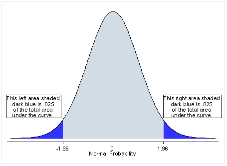

## {}

::: columns
::: {.column width="37.5%"}
{style="margin-left:-60px"}
:::

::: {.column width="60%"}
::: {.title data-id="title"}
Módulo 2: Introducción a la estadística inferencial con R
:::

Mauricio Moreno, PhD

Domingo 22 de noviembre de 2026
:::
:::

{.image-left}

## Hoy

1.  Muestras, poblaciones, parámetros y estadísticos
2.  Intervalos de confianza
3.  Pruebas de hipótesis y el valor p
4.  Supuestos y transformaciones de variables
5.  Pruebas t: una muestra, dos muestras independientes, muestras emparejadas
6.  Pruebas de Wilcoxon

. . .

::: callout-note
El domingo pasado aprendimos a **describir** una muestra. Hoy usamos la muestra para **sacar conclusiones sobre la población** de la que viene.
:::

## Los datos de hoy {.smaller}


-   `glucosa`: glucosa (mg/dL) de 10 ratones de una línea que podría servir como modelo de hiperglucemia (datos ilustrativos).
-   `genderweight`, del paquete `{datarium}`: contiene el peso por sexo (M: hombres, F: mujeres) de 40 participantes.
-   `mice2`, del paquete `{datarium}`: contiene el peso de 10 ratones antes y después de un tratamiento.
-   `crime`, del paquete `{UsingR}`: tasas de crimen (reportes por cada 100 000 habitantes) en los estados de EE. UU. en 1983 y en 1993.
-   `felicidad`: medida de felicidad de un grupo de estudiantes antes y después de tomar una clase de estadística.

```{r}
#| code-fold: true
glucosa <- c(108.7, 93.7, 52.7, 79.0, 74.7, 131.9, 99.5, 63.3, 98.6, 92.7)

# install.packages("UsingR")   # solo la primera vez
# install.packages("datarium") # solo la primera vez
library(UsingR)
library(datarium)
data(crime)
data(genderweight)
data(mice2)

felicidad <- data.frame(before = c(30,43,21,24,23,40,29,56,38,16),
                        after = c(6,29,11,31,17,2,31,21,8,21))
```

# Muestras y poblaciones

## Población y muestra {.smaller}

::: columns
::: {.column width="55%"}
{target="_blank"}](images/simple1.png){fig-align="center"}
:::

::: {.column width="45%"}
::: incremental
-   **Población:** todos los individuos sobre los que queremos concluir (por ejemplo, todos los ratones de una línea).
-   **Muestra:** los que realmente medimos (por ejemplo, los 10 ratones de `glucosa`).
-   En un **muestreo aleatorio simple**, cada individuo tiene la misma probabilidad de ser elegido.
:::
:::
:::

## Parámetros y estadísticos {.smaller}

| | Población (**parámetro**) | Muestra (**estadístico**) |
|:--|:--:|:--:|
| Media | $\mu$ | $\bar{x}$ |
| Desviación estándar | $\sigma$ | $s$ |
| Varianza | $\sigma^2$ | $s^2$ |

. . .

::: incremental
-   Los parámetros casi nunca los conocemos: los **estimamos** con los estadísticos.
-   Otra muestra daría otra $\bar{x}$. ¿Cuánto puede cambiar? Eso nos lo dice el **error estándar**, $s / \sqrt{n}$.
:::

## Explorar los datos: `glucosa` {.smaller}

Antes de cualquier prueba, miramos los datos: 10 ratones, glucosa en mg/dL.

```{r}
#| code-fold: true
#| fig-height: 3.8
#| fig-width: 11
par(mfrow = c(1, 2))
stripchart(glucosa, method = "stack", pch = 19, col = "#0072B2",
           xlab = "Glucosa (mg/dL)", main = "Cada punto es un ratón")
abline(v = mean(glucosa), lty = 2)
boxplot(glucosa, horizontal = TRUE, xlab = "Glucosa (mg/dL)", main = "Diagrama de caja")
```

```{r}
summary(glucosa)
```

::: incremental
-   ¿Dónde está el centro? ¿Hay valores muy alejados? Con solo 10 datos, cada ratón pesa mucho en la media.
:::

## Intervalos de confianza {.smaller}

Un intervalo de confianza del 95% para la media:

$$
\bar{x} \pm t_{0.975,\ n-1} \cdot \frac{s}{\sqrt{n}}
$$

. . .

```{r}
t.test(glucosa)$conf.int
```

. . .

::: callout-important
## ¿Qué significa "95% de confianza"?
Si repitiéramos el estudio muchas veces, el 95% de los intervalos calculados así contendría la media verdadera $\mu$.
:::

## Intervalos de confianza {visibility="uncounted" .smaller}

50 muestras de $n = 10$ de una población con $\mu = 90$:

```{r}
#| code-fold: true
#| fig-height: 4.5
#| fig-width: 11
set.seed(2026)
ic <- t(replicate(50, t.test(rnorm(10, mean = 90, sd = 20))$conf.int))
fuera <- ic[, 1] > 90 | ic[, 2] < 90
plot(NULL, xlim = c(1, 50), ylim = range(ic), xlab = "Muestra", ylab = "IC 95%")
segments(1:50, ic[, 1], 1:50, ic[, 2], lwd = 2, col = ifelse(fuera, "#D55E00", "#0072B2"))
abline(h = 90, lty = 2)
```

Los intervalos en naranja no contienen a $\mu$: son `r sum(fuera)` de 50.

## {}

::: columns
::: {.column width="37.5%"}
:::

::: {.column width="60%"}
::: {.title data-id="title"}
[Ejercicios, Parte 1](../ejercicios-2.html#parte-1){target="_blank"}
:::

::: {.timer #Timer1 seconds=600 starton=interaction}
:::
:::
:::

{.image-left}

# Pruebas de hipótesis

## Hipótesis de investigación vs. hipótesis estadísticas {.smaller}

::: incremental
-   Una **hipótesis de investigación** expresa, de forma general, una idea científica sobre un tema de interés. Ejemplos: *fumar causa cáncer*, *esta vacuna previene la enfermedad*.

    -   No dice todavía **cómo** la vamos a poner a prueba ni **en qué medida** esperamos un efecto.

-   Una **hipótesis estadística**, en cambio, es una afirmación matemáticamente precisa sobre un parámetro de la población (por ejemplo, $\mu_1 = \mu_2$), que podemos contrastar con los datos.

    -   Una prueba estadística no "prueba" ni "demuestra" nada: indica si los datos son compatibles o no con $H_0$.

    -   Sus conclusiones valen solo para la **población de la que se tomó la muestra**. Por eso es clave definir bien esa población: el ratón es el modelo animal más usado y uno de los primeros pasos de muchas investigaciones, pero lo que encontramos en ratones **no** se puede trasladar directamente a seres humanos.
:::

## De la pregunta a las hipótesis {.smaller}

::: incremental
-   **Pregunta de investigación:** ¿la escasez de alimento cambia el tiempo que tardan los renacuajos en reabsorber la cola?
-   **Hipótesis nula**, $H_0$: no hay diferencia, $\mu_{Hi} = \mu_{Lo}$.
-   **Hipótesis alternativa**, $H_1$: sí hay diferencia, $\mu_{Hi} \neq \mu_{Lo}$.
-   La prueba estadística mide **qué tan compatibles** son los datos con $H_0$.
:::

## Tamaño de efecto {.smaller}

-   Las hipótesis que vimos se pueden reordenar en términos de la **diferencia** entre las medias:

$$
\begin{aligned}
H_0 &: \mu_{Hi} - \mu_{Lo} = 0 \\
H_1 &: \mu_{Hi} - \mu_{Lo} \neq 0
\end{aligned}
$$

::: incremental
-   Esa diferencia es el **tamaño de efecto**: *cuánto* cambia la respuesta entre los tratamientos. Es lo que queremos estimar, con su intervalo de confianza.
-   Que el efecto sea **significativo** es otra cosa: depende de su tamaño **y** de su incertidumbre (tamaño de muestra, variabilidad). Un efecto pequeño puede ser significativo con muchos datos, y uno grande puede no serlo con pocos.
-   En general lo llamamos $\theta$. No siempre nos interesa compararlo con cero, sino con otro valor de referencia, $\theta_0$:
:::

. . .

$$
\begin{aligned}
H_0 &: \theta = \theta_0 \\
H_1 &: \theta \neq \theta_0
\end{aligned}
\qquad \text{con } \theta = \mu_{Hi} - \mu_{Lo}
$$

. . .

En la prueba t de una muestra, $\theta = \mu - \mu_0$: por ejemplo, ¿cuánto se aleja la glucosa media de 80 mg/dL?


## Tipos de errores {.smaller}

| | $H_0$ es verdadera | $H_0$ es falsa |
|:--|:--:|:--:|
| **Rechazamos** $H_0$ | Error tipo I ($\alpha$) | Correcto (potencia, $1 - \beta$) |
| **No rechazamos** $H_0$ | Correcto ($1 - \alpha$) | Error tipo II ($\beta$) |

. . .

::: incremental
-   $\alpha$, el **nivel de significancia**, lo fijamos nosotros: por lo general 0.05.
-   La **potencia** de una prueba estadística es la probabilidad de rechazar la hipótesis nula cuando esta es de hecho falsa.
-   La potencia **crece** con el tamaño de la muestra, con el tamaño del efecto y con $\alpha$, y **disminuye** con la variabilidad de los datos. Mientras más cercana a 1, mejor; por lo general se busca al menos 0.8.
-   Al final del Módulo 3 veremos cómo calcular el tamaño de muestra a partir de la potencia deseada.
:::

## Pruebas de dos colas y de una cola {.smaller}

::: columns
::: {.column width="50%"}
{fig-align="center" width="400"}
:::

::: {.column width="50%"}
{fig-align="center" width="400"}
:::
:::

En R: `alternative = "two.sided"` (por defecto), `"greater"` o `"less"`.

::: footer
Imágenes: [UCLA Advanced Research Computing](https://stats.oarc.ucla.edu/other/mult-pkg/faq/general/faq-what-are-the-differences-between-one-tailed-and-two-tailed-tests/){target="_blank"}
:::

## El valor p {.smaller}

::: columns
::: {.column width="45%"}
{fig-align="center"}
:::

::: {.column width="55%"}
::: incremental
-   Es la probabilidad de obtener datos **tan extremos como los nuestros, o más**, *si* $H_0$ fuera verdadera.
-   Si $p < \alpha$, rechazamos $H_0$.
-   **No** es la probabilidad de que $H_0$ sea verdadera.
-   **No** dice si el efecto es grande o importante: para eso, mira la diferencia y su intervalo.
:::
:::
:::

# Pruebas estadísticas paramétricas

## Pruebas t {.smaller}

::: incremental
-   Las pruebas t comparan una media aritmética con un valor de referencia, o dos medias aritméticas entre sí.

-   La $H_0$ en estas pruebas es que la diferencia ($\theta$) es igual al valor de referencia, casi siempre cero.

-   Se rechaza la $H_0$ cuando el valor p resultante es menor que $\alpha$ (por lo general, 0.05).

-   Existen tres tipos de pruebas t

    -   Pruebas t de una muestra

    -   Pruebas t de muestras independientes

    -   Pruebas t de muestras emparejadas

-   Estas pruebas fueron desarrolladas bajo la suposición de la **normalidad** y de **homogeneidad de las varianzas**.

-   Según el teorema del límite central, con muestras grandes la **media muestral** tiene una distribución aproximadamente normal, aunque los datos no lo sean. Por eso la prueba t es bastante robusta con muchos datos.

-   Cuando el número de observaciones es pequeño, conviene revisar la normalidad para decidir entre una prueba t y una de sus alternativas.
:::


## Explorar los datos: `crime` {.smaller}

Tasas de crimen (reportes por cada 100 000 habitantes) en los mismos estados de EE. UU., en 1983 y en 1993.

```{r}
#| code-fold: true
#| fig-height: 3.8
#| fig-width: 11
par(mfrow = c(1, 2))
boxplot(crime$y1983, crime$y1993, names = c("1983", "1993"), ylab = "Tasa de crimen",
        main = "Cada año por separado")
plot(crime$y1983, crime$y1993, pch = 19, col = "#0072B2",
     xlab = "Tasa en 1983", ylab = "Tasa en 1993", main = "Cada punto es un estado")
abline(a = 0, b = 1, lty = 2)
```

::: incremental
-   Los mismos estados se miden dos veces: los datos están **emparejados**. Los puntos sobre la línea punteada son estados donde la tasa subió.
-   Hay unos pocos valores muy altos: una cola larga a la derecha. Lo vemos en detalle a continuación.
:::

## Supuestos {.smaller}

::: incremental
1.  Observaciones **independientes**.
2.  Datos (o diferencias) con distribución **normal**, o una muestra grande.
3.  Para dos muestras: **varianzas homogéneas** (solo para la prueba de Student).
:::

. . .

```{r}
#| code-fold: true
#| fig-height: 4
#| fig-width: 10
par(mfrow = c(1, 2))
hist(crime$y1983, main = "", xlab = "Tasa de crimen en 1983")
qqnorm(crime$y1983, main = ""); qqline(crime$y1983)
```

## Supuestos en la práctica {.smaller}

$H_0$ de Shapiro-Wilk: los datos vienen de una distribución normal. $H_0$ de `var.test()`: las dos varianzas son iguales.

::: columns
::: {.column .fragment width="50%"}
Normalidad 1983

```{r}
shapiro.test(crime$y1983)
```
:::

::: {.column .fragment width="50%"}
Normalidad 1993

```{r}
shapiro.test(crime$y1993)
```
:::
:::

. . .

```{r}
var.test(crime$y1983, crime$y1993)
```

. . .

::: callout-tip
Con muestras grandes, Shapiro-Wilk detecta desviaciones mínimas y sin importancia. Mira siempre **también el gráfico Q-Q**. Y la homogeneidad de las varianzas solo importa al comparar **grupos independientes**: si los datos están emparejados (como los mismos estados en dos años), no es un supuesto.
:::

## Transformación de variables {.smaller}

::: incremental
-   Antes de pasar a pruebas no paramétricas, podemos **transformar** la variable para volver a las pruebas paramétricas.
-   El objetivo es poder **revertir la transformación** y concluir en las unidades originales.
-   La misma transformación **debe** aplicarse a todos los grupos que se comparan: no tiene sentido comparar grupos transformados de formas distintas.
-   Con muy pocas observaciones, casi ninguna transformación funciona: mejor usar directamente una prueba no paramétrica.
:::

. . .

| Transformación | En R | Cuándo suele funcionar |
|:--|:--|:--|
| Logaritmo | `log(y)` | tiempos, masas, tasas, concentraciones (valores positivos) |
| Logaritmo con ceros | `log(y + 1)` | como la anterior, si hay ceros |
| Raíz cuadrada | `sqrt(y)` | conteos |
| Cuadrado | `y^2` | colas largas a la izquierda |

Un método más general es la [transformación de Box-Cox](https://www.r-bloggers.com/2022/10/box-cox-transformation-in-r/){target="_blank"} (`MASS::boxcox()`), que busca la potencia que mejor normaliza los datos.

## Transformación de variables {.smaller visibility="uncounted"}

::: columns
::: {.column .fragment width="50%"}
Raíz cuadrada

```{r}
shapiro.test(sqrt(crime$y1983))$p.value
```

Elevar al cuadrado

```{r}
shapiro.test(crime$y1983^2)$p.value
```
:::

::: {.column .fragment width="50%"}
Logaritmo

```{r}
shapiro.test(log(crime$y1983))$p.value
```

Chequeemos con el otro año

```{r}
shapiro.test(log(crime$y1993))$p.value
```
:::
:::

. . .

Homogeneidad de las varianzas con la transformación logarítmica:

```{r}
var.test(log(crime$y1983), log(crime$y1993))$p.value
```

## Prueba t de una muestra 

::: incremental
-   Es usada para comparar la media aritmética de una muestra con un valor conocido (un estándar por ejemplo).

-   Por lo general el valor al que se va a comparar proviene de referencias bibliográficas, pre-experimentos o suposiciones fundamentadas.

-   En este caso, el supuesto que debe cumplirse es el de la normalidad de los datos.

-   Usaremos la tabla de datos de los ratones: `glucosa`
:::


## Prueba t de una muestra {.smaller visibility="uncounted"}

Supongamos que tenemos un grupo de 10 ratones que podrían ser parte de un linaje para usar como modelo de hiperglucemia, y medimos su glucosa en sangre (`glucosa`).

¿Es la glucosa media de esta línea de ratones distinta de 80 mg/dL, el límite inferior en ratones sanos?

. . .

```{r}
shapiro.test(glucosa)$p.value
```

. . .

```{r}
ratest <- t.test(glucosa, mu = 80)
ratest
```

## Prueba t de muestras independientes

::: incremental
-   Es usada para comparar las medias aritméticas de dos grupos independientes.

-   Por ejemplo, si deseas comparar las medias aritméticas de individuos agrupados por sexo.

-   Para ilustrar esta prueba, vamos a hacer uso de la tabla de datos de `genderweight` del paquete `{datarium}`.

-   Veamos si existe una diferencia significativa en la media del peso entre hombres y mujeres
:::


## Explorar los datos: `genderweight` {.smaller visibility="uncounted"}

```{r}
#| code-fold: true
#| fig-height: 4
#| fig-width: 8
boxplot(weight ~ group, data = genderweight, names = c("Mujeres (F)", "Hombres (M)"),
        xlab = NULL, ylab = "Peso (kg)", col = "white")
stripchart(weight ~ group, data = genderweight, vertical = TRUE, method = "jitter",
           pch = 19, col = adjustcolor("#0072B2", 0.6), add = TRUE)
```

```{r}
tapply(genderweight$weight, genderweight$group, summary)
```

::: incremental
-   Dos grupos **independientes**: cada persona pertenece a uno solo. ¿Difieren los centros? ¿Y la dispersión?
:::

## Prueba t de muestras independientes {.smaller visibility="uncounted"}

¿Difieren la media del peso entre hombres y mujeres?

::: columns
::: {.column .fragment width="50%"}
Chequeamos normalidad: Group M

```{r echo=T, eval=T, error=T}
shapiro.test(subset(genderweight, group == "M")$weight)     
```
:::

::: {.column .fragment width="50%"}
Chequeamos normalidad: Group F

```{r echo=T, eval=T, error=T}
shapiro.test(subset(genderweight, group == "F")$weight)     
```
:::
:::

. . .

Chequeamos la homogeneidad de las varianzas

```{r echo=T, eval=T, error=T}
var.test(genderweight$weight ~ genderweight$group)
```

::: incremental
-   **¡La homogeneidad de las varianzas no se cumple!** 😱
:::

## Student o Welch {.smaller}

::: incremental
-   Por defecto, `t.test()` hace la prueba de **Welch**, que no supone varianzas iguales. Por eso sus grados de libertad tienen decimales.
-   La prueba de **Student** clásica necesita `var.equal = TRUE`.
-   Si las varianzas son parecidas, las dos dan casi lo mismo. Si no lo son, Welch es la segura.
:::

. . .

```{r echo=T, eval=T, error=T}
gendertest <- t.test(genderweight$weight ~ genderweight$group)
gendertest
```

## Prueba t de muestras emparejadas {.smaller}

::: incremental
-   Es usada para comparar las medias de dos grupos que guardan una relación.

-   Esto ocurre generalmente cuando las medidas se han realizado en las mismas unidades experimentales. Ejemplos: individuos al inicio y al final de un tratamiento, muestras en una misma locación geográfica. 

-   Para esta prueba, vamos a usar la tabla de datos `mice2` del paquete `{datarium}`

-   Veamos si existe una diferencia en el peso de los ratones antes y después de haber sido sometidos a una determinada dieta.

:::

. . .

```{r echo=T, eval=T, error=T}
data(mice2)
```

## Explorar los datos: `mice2` {.smaller visibility="uncounted"}

```{r}
#| code-fold: true
#| fig-height: 4
#| fig-width: 11
par(mfrow = c(1, 2))
matplot(rbind(mice2$before, mice2$after), type = "b", pch = 19, lty = 1, col = "#0072B2",
        xaxt = "n", xlab = NULL, ylab = "Peso (g)", main = "Cada línea es un ratón")
axis(1, at = 1:2, labels = c("Antes", "Después"))
hist(mice2$after - mice2$before, main = "Diferencias (después - antes)", xlab = "Cambio de peso (g)")
```

::: incremental
-   Cada ratón se mide dos veces. Lo que interesa es **cuánto cambia cada uno**: por eso la prueba trabaja con las diferencias.
:::

## Prueba t de muestras emparejadas {.smaller visibility="uncounted"}

::: incremental
-   En una prueba emparejada, cada ratón es su propio control: la prueba trabaja con las **diferencias** dentro de cada ratón.
-   Por eso, el supuesto de normalidad se revisa sobre las **diferencias**, no sobre cada grupo por separado.
-   La homogeneidad de las varianzas **no** es un supuesto de esta prueba.
:::

. . .

```{r echo=T, eval=T, error=T}
diferencias <- mice2$after - mice2$before
shapiro.test(diferencias)
```

## Prueba t de muestras emparejadas {.smaller visibility="uncounted"}

```{r echo=T, eval=T, error=T}
micetest <- t.test(mice2$after, mice2$before, paired = TRUE)
micetest
```

## Muestras emparejadas con transformación {.smaller}

¿Cambió la tasa de crimen entre 1983 y 1993? Cada estado se mide dos veces: las muestras están **emparejadas**. Revisamos la normalidad de las diferencias, en las unidades originales y en logaritmo:

```{r}
shapiro.test(crime$y1993 - crime$y1983)$p.value
shapiro.test(log(crime$y1993) - log(crime$y1983))$p.value
```

. . .

```{r}
prueba_crimen <- t.test(log(crime$y1993), log(crime$y1983), paired = TRUE)
prueba_crimen
```

. . .

De vuelta en las unidades originales, con `exp()`:

```{r}
cat("media de 1983 = ", exp(mean(log(crime$y1983))), "\nmedia de 1993 = ",  exp(mean(log(crime$y1993))), "\ncociente 1993/1983 = ", exp(prueba_crimen$estimate), "\nIC 95% del cociente", exp(prueba_crimen$conf.int))
```

::: callout-tip
En escala logarítmica, la diferencia de medias se convierte en un **cociente** de medias geométricas: cuántas veces cambió la tasa de crimen de un año a otro.
:::

## {}

::: columns
::: {.column width="37.5%"}
:::

::: {.column width="60%"}
::: {.title data-id="title"}
[Ejercicios, Parte 2](../ejercicios-2.html#parte-2){target="_blank"}
:::

::: {.timer #Timer2 seconds=1200 starton=interaction}
:::
:::
:::

{.image-left}

# Pruebas estadísticas no paramétricas

## Pruebas de Wilcoxon para datos no normales 


::: incremental
-   Las pruebas de **Wilcoxon** comparan **rangos** (posiciones) en lugar de medias.
-   No suponen normalidad, pero sí observaciones independientes.
-   Una muestra: ¿la mediana es distinta de un valor de referencia?
-   Dos muestras (también llamada de Mann-Whitney): ¿un grupo tiende a tener valores más altos que el otro?
    
:::


## Explorar los datos: `felicidad` {.smaller}

```{r}
#| code-fold: true
#| fig-height: 4
#| fig-width: 11
par(mfrow = c(1, 2))
matplot(rbind(felicidad$before, felicidad$after), type = "b", pch = 19, lty = 1, col = "#D55E00",
        xaxt = "n", xlab = NULL, ylab = "Felicidad", main = "Cada línea es un estudiante")
axis(1, at = 1:2, labels = c("Antes", "Después"))
stripchart(felicidad$after - felicidad$before, method = "stack", pch = 19, col = "#D55E00",
           xlab = "Cambio de felicidad (después - antes)", main = "Diferencias")
abline(v = 0, lty = 2)
```

::: incremental
-   Solo 10 estudiantes, y las diferencias no se ven simétricas: con tan pocos datos, no podemos confiar en la normalidad. Por eso usaremos Wilcoxon.
:::

## Wilcoxon para una muestra {.smaller}

¿Existe una diferencia en el nivel de felicidad de los estudiantes antes y después de tomar una clase de estadística?

```{r}
felicidad$change <- felicidad$after - felicidad$before

muestra_wilcox <- wilcox.test(felicidad$change, mu = 0)
muestra_wilcox
```

::: callout-note
Probar que la mediana de los cambios es 0 es lo mismo que una prueba de Wilcoxon **emparejada**: `wilcox.test(felicidad$after, felicidad$before, paired = TRUE)` da el mismo resultado. Es la alternativa no paramétrica a la prueba t emparejada.
:::

## Prueba de Wilcoxon para dos muestras

::: incremental
-   Regresando al ejemplo de la tabla de datos `genderweight`, supongamos que estos no están normalmente distribuidos.

-   Usaremos la prueba de Wilcoxon para muestras independientes para ver si existe diferencia entre los pesos de hombres y mujeres.
:::

. . .

```{r echo=T, eval=T, error=T}
dos_wilcox <- wilcox.test(genderweight$weight ~ genderweight$group)
dos_wilcox
```


## ¿Qué prueba uso? {.smaller}

| Pregunta | Datos normales | Datos no normales |
|:--|:--|:--|
| ¿Media (o mediana) igual a un valor? | `t.test(x, mu = )` | transformar, o `wilcox.test(x, mu = )` |
| ¿Difieren dos grupos independientes? | `t.test(y ~ grupo)` | transformar, o `wilcox.test(y ~ grupo)` |
| ¿Cambian los mismos individuos? | `t.test(x2, x1, paired = TRUE)` | `wilcox.test(x2, x1, paired = TRUE)` |
| ¿Difieren **tres o más** grupos? | ANOVA ([Módulo 3](modulo-3.html)) | Kruskal-Wallis ([Módulo 3](modulo-3.html)) |

## `{report}` {.smaller}

::: incremental

-   El redactar resultados estadísticos puede resultar en una tarea compleja.

-   Afortunadamente contamos con la ayuda de `{report}`, parte del multiverso `{easystats}` que nos puede dar guías para ello.

:::

. . .

```{r echo=T, eval=F, error=T}
install.packages("easystats")
library(report)
```

```{r echo=F, eval=T, error=T}
library(report)
```

```{r echo=T, eval=T, error=T}
report(dos_wilcox)
```

```{r echo=T, eval=T, error=T}
report(gendertest)
```

::: callout-warning
`report()` redacta en las unidades de la prueba. Si la prueba se hizo sobre datos transformados (como `prueba_crimen`), las cifras quedan en logaritmos: vuelve a las unidades originales con `exp()` antes de redactar.
:::

## {}

::: columns
::: {.column width="37.5%"}
:::

::: {.column width="60%"}
::: {.title data-id="title"}
[Ejercicios, Parte 3](../ejercicios-2.html#parte-3){target="_blank"}
:::

::: {.timer #Timer3 seconds=900 starton=interaction}
:::
:::
:::

{.image-left}

## Antes del próximo domingo {.smaller}

::: incremental
1.  Completa **todos** los [ejercicios](../ejercicios-2.html){target="_blank"} del Módulo 2: lo que no alcanzamos en clase, incluida la Parte 4, es tarea.
2.  Con tus propios datos, escribe una pregunta que se responda con una prueba t: plantea $H_0$ y $H_1$ y revisa los supuestos antes de correrla.
3.  Haz la [autoevaluación](../autoevaluacion-2.html){target="_blank"} del Módulo 2.
:::

## {}

::: columns
::: {.column width="60%"}
::: {.title data-id="title"}
Fin del módulo 2
:::

::: callout-tip
## Créditos de fotos

Foto final por <a href="https://unsplash.com/@hongkyu?utm_content=creditCopyText&utm_medium=referral&utm_source=unsplash">PARK HONG KYU</a> en <a href="https://unsplash.com/photos/white-and-black-boat-on-sea-during-sunset-f7efwMH5esE?utm_content=creditCopyText&utm_medium=referral&utm_source=unsplash">Unsplash</a>

Resto de fotos: varias fuentes
:::
:::

::: {.column width="37.5%"}
{style="margin-left:120px"}
:::
:::

{.image-right}
