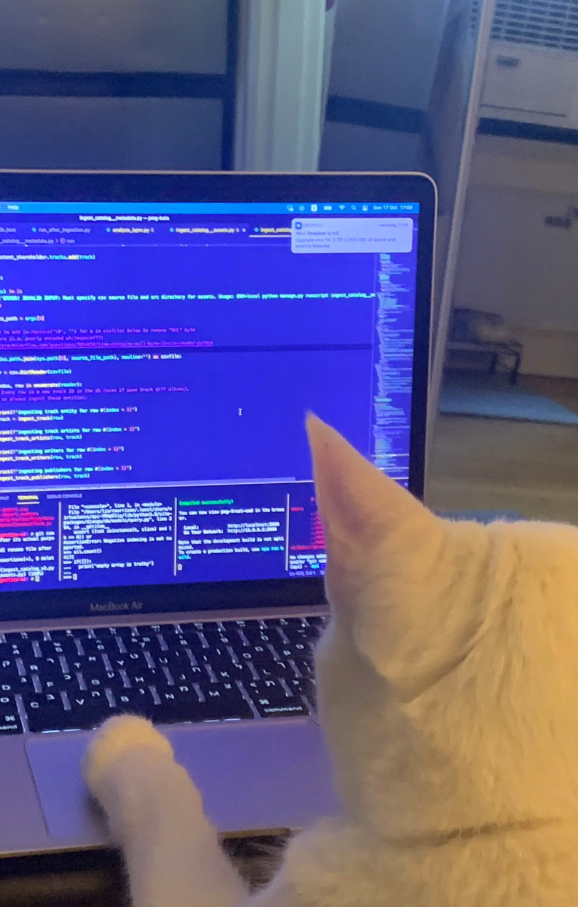
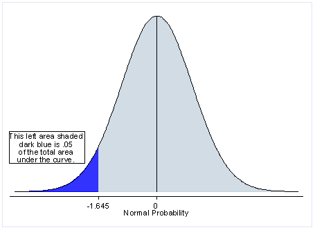
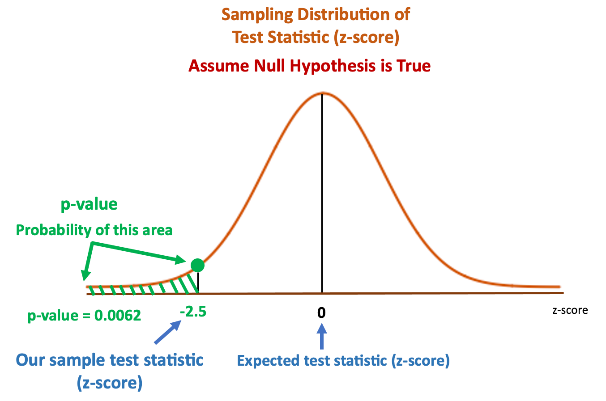

## {}

::: columns
::: {.column width="37.5%"}
{style="margin-left:-60px"}
:::

::: {.column width="60%"}
::: {.title data-id="title"}
Módulo 2: Introducción a la estadística inferencial con R
:::

Mauricio Moreno, PhD

Domingo 22 de noviembre de 2026
:::
:::

{.image-left}

## Hoy

1.  Muestras, poblaciones, parámetros y estadísticos
2.  Intervalos de confianza
3.  Pruebas de hipótesis y el valor p
4.  Pruebas t: una muestra, dos muestras independientes, muestras emparejadas
5.  Pruebas de Wilcoxon y transformaciones

. . .

::: callout-note
El domingo pasado aprendimos a **describir** una muestra. Hoy usamos la muestra para **sacar conclusiones sobre la población** de la que viene.
:::

## Los datos de hoy {.smaller}

Usamos la tabla `ranas` del [Módulo 1](modulo-1.html), con los tratamientos como **factores**.

```{r}
#| code-fold: true
ranas <- read.csv("datos/ranas.csv")
ranas$Pred  <- factor(ranas$Pred)
ranas$Res   <- factor(ranas$Res)
ranas$Hatch <- factor(ranas$Hatch)
str(ranas)
```

# Muestras y poblaciones

## Población y muestra {.smaller}

::: columns
::: {.column width="55%"}
{target="_blank"}](images/simple1.png){fig-align="center"}
:::

::: {.column width="45%"}
::: incremental
-   **Población:** todos los individuos sobre los que queremos concluir (todos los renacuajos de la especie).
-   **Muestra:** los que realmente medimos (78 tanques).
-   En un **muestreo aleatorio simple**, cada individuo tiene la misma probabilidad de ser elegido.
:::
:::
:::

## Parámetros y estadísticos {.smaller}

| | Población (**parámetro**) | Muestra (**estadístico**) |
|:--|:--:|:--:|
| Media | $\mu$ | $\bar{x}$ |
| Desviación estándar | $\sigma$ | $s$ |
| Varianza | $\sigma^2$ | $s^2$ |

. . .

::: incremental
-   Los parámetros casi nunca los conocemos: los **estimamos** con los estadísticos.
-   Otra muestra daría otra $\bar{x}$. ¿Cuánto puede cambiar? Eso nos lo dice el **error estándar**, $s / \sqrt{n}$.
:::

## Intervalos de confianza {.smaller}

Un intervalo de confianza del 95% para la media:

$$
\bar{x} \pm t_{0.975,\ n-1} \cdot \frac{s}{\sqrt{n}}
$$

. . .

```{r}
t.test(ranas$SVL.final)$conf.int
```

. . .

::: callout-important
## ¿Qué significa "95% de confianza"?
Si repitiéramos el estudio muchas veces, el 95% de los intervalos calculados así contendría la media verdadera $\mu$.
:::

## Intervalos de confianza {visibility="uncounted" .smaller}

50 muestras de $n = 10$ de una población con $\mu = 90$:

```{r}
#| code-fold: true
#| fig-height: 4.5
#| fig-width: 11
set.seed(2026)
ic <- t(replicate(50, t.test(rnorm(10, mean = 90, sd = 20))$conf.int))
fuera <- ic[, 1] > 90 | ic[, 2] < 90
plot(NULL, xlim = c(1, 50), ylim = range(ic), xlab = "Muestra", ylab = "IC 95%")
segments(1:50, ic[, 1], 1:50, ic[, 2], lwd = 2, col = ifelse(fuera, "#D55E00", "#0072B2"))
abline(h = 90, lty = 2)
```

Los intervalos en naranja no contienen a $\mu$: son `r sum(fuera)` de 50.

## {}

::: columns
::: {.column width="37.5%"}
:::

::: {.column width="60%"}
::: {.title data-id="title"}
[Ejercicios, Parte 1](../ejercicios-2.html#parte-1){target="_blank"}
:::

::: {.timer #Timer1 seconds=600 starton=interaction}
:::
:::
:::

{.image-left}

# Pruebas de hipótesis

## De la pregunta a las hipótesis {.smaller}

::: incremental
-   **Pregunta de investigación:** ¿la escasez de alimento cambia el tiempo que tardan los renacuajos en reabsorber la cola?
-   **Hipótesis nula**, $H_0$: no hay diferencia, $\mu_{Hi} = \mu_{Lo}$.
-   **Hipótesis alternativa**, $H_1$: sí hay diferencia, $\mu_{Hi} \neq \mu_{Lo}$.
-   La prueba estadística mide **qué tan compatibles** son los datos con $H_0$.
:::

## Tipos de errores {.smaller}

| | $H_0$ es verdadera | $H_0$ es falsa |
|:--|:--:|:--:|
| **Rechazamos** $H_0$ | Error tipo I ($\alpha$) | Correcto (potencia, $1 - \beta$) |
| **No rechazamos** $H_0$ | Correcto | Error tipo II ($\beta$) |

. . .

::: incremental
-   $\alpha$, el **nivel de significancia**, lo fijamos nosotros: por lo general 0.05.
-   La **potencia** crece con el tamaño de la muestra y con el tamaño del efecto.
:::

## Pruebas de dos colas y de una cola {.smaller}

::: columns
::: {.column width="50%"}
{fig-align="center" width="400"}
:::

::: {.column width="50%"}
{fig-align="center" width="400"}
:::
:::

En R: `alternative = "two.sided"` (por defecto), `"greater"` o `"less"`.

::: footer
Imágenes: [UCLA Advanced Research Computing](https://stats.oarc.ucla.edu/other/mult-pkg/faq/general/faq-what-are-the-differences-between-one-tailed-and-two-tailed-tests/){target="_blank"}
:::

## El valor p {.smaller}

::: columns
::: {.column width="45%"}
{fig-align="center"}
:::

::: {.column width="55%"}
::: incremental
-   Es la probabilidad de obtener datos **tan extremos como los nuestros, o más**, *si* $H_0$ fuera verdadera.
-   Si $p < \alpha$, rechazamos $H_0$.
-   **No** es la probabilidad de que $H_0$ sea verdadera.
-   **No** dice si el efecto es grande o importante: para eso, mira la diferencia y su intervalo.
:::
:::
:::

# Pruebas t

## Supuestos {.smaller}

::: incremental
1.  Observaciones **independientes**.
2.  Datos (o diferencias) con distribución **normal**, o una muestra grande.
3.  Para dos muestras independientes: **varianzas homogéneas** (solo para la prueba de Student).
:::

. . .

```{r}
#| fig-height: 4
#| fig-width: 10
par(mfrow = c(1, 2))
hist(ranas$Mass.final, main = "", xlab = "Masa final (g)")
qqnorm(ranas$Mass.final, main = ""); qqline(ranas$Mass.final)
```

## Normalidad: Shapiro-Wilk {.smaller}

$H_0$: los datos vienen de una distribución normal.

```{r}
shapiro.test(ranas$Mass.final)
```

. . .

::: callout-tip
Con muestras grandes, Shapiro-Wilk detecta desviaciones mínimas y sin importancia. Mira siempre **también el gráfico Q-Q**.
:::

## Prueba t de una muestra {.smaller}

¿Es la masa media al salir del agua distinta de 0.40 g?

```{r}
t.test(ranas$Mass.final, mu = 0.40)
```

## Prueba t de muestras independientes {.smaller}

¿Difiere la longitud final entre renacuajos de eclosión temprana (`E`) y tardía (`L`)?

```{r}
var.test(SVL.final ~ Hatch, data = ranas)
```

. . .

```{r}
t.test(SVL.final ~ Hatch, data = ranas)
```

## Student o Welch {.smaller}

::: incremental
-   Por defecto, `t.test()` hace la prueba de **Welch**, que no supone varianzas iguales. Por eso sus grados de libertad tienen decimales.
-   La prueba de **Student** clásica necesita `var.equal = TRUE`.
-   Si las varianzas son parecidas, las dos dan casi lo mismo. Si no lo son, Welch es la segura.
:::

. . .

```{r}
t.test(SVL.final ~ Hatch, data = ranas, var.equal = TRUE)$p.value
```

## Prueba t de muestras emparejadas {.smaller}

Datos `sleep`, incluidos en R: horas extra de sueño de **los mismos** 10 pacientes con dos medicamentos.

```{r}
#| code-fold: true
droga_1 <- sleep$extra[sleep$group == 1]
droga_2 <- sleep$extra[sleep$group == 2]
shapiro.test(droga_2 - droga_1)
```

. . .

```{r}
t.test(droga_2, droga_1, paired = TRUE)
```

## {}

::: columns
::: {.column width="37.5%"}
:::

::: {.column width="60%"}
::: {.title data-id="title"}
[Ejercicios, Parte 2](../ejercicios-2.html#parte-2){target="_blank"}
:::

::: {.timer #Timer2 seconds=1500 starton=interaction}
:::
:::
:::

{.image-left}

# Pruebas de Wilcoxon y transformaciones

## ¿Y si los datos no son normales? {.smaller}

::: incremental
-   Las pruebas de **Wilcoxon** comparan **rangos** (posiciones) en lugar de medias.
-   No suponen normalidad, pero sí observaciones independientes.
-   Una muestra: ¿la mediana es distinta de un valor de referencia?
-   Dos muestras (también llamada de Mann-Whitney): ¿un grupo tiende a tener valores más altos que el otro?
:::

. . .

```{r}
shapiro.test(ranas$Age.FromEmergence)
```

## Wilcoxon para una y dos muestras {.smaller}

¿La mediana de la edad al salir del agua es distinta de 20 días?

```{r}
wilcox.test(ranas$Age.FromEmergence, mu = 20)
```

. . .

¿Difiere entre eclosión temprana y tardía?

```{r}
wilcox.test(Age.FromEmergence ~ Hatch, data = ranas)
```

## Otra opción: transformar {.smaller}

Si los datos tienen una cola larga a la derecha, una **transformación** puede acercarlos a la normalidad y permitir la prueba t.

| Transformación | En R | Cuándo |
|:--|:--|:--|
| Logaritmo | `log(y)` | tiempos, masas, concentraciones (valores positivos) |
| Logaritmo con ceros | `log(y + 1)` | como la anterior, si hay ceros |
| Raíz cuadrada | `sqrt(y)` | conteos |

. . .

```{r}
#| code-fold: true
#| fig-height: 3.4
#| fig-width: 11
par(mfrow = c(1, 2))
hist(ranas$Age.FromEmergence, main = "En días", xlab = "Edad al salir del agua")
hist(log(ranas$Age.FromEmergence), main = "En logaritmo", xlab = "log(edad)")
```

## Prueba t sobre el logaritmo {.smaller}

```{r}
shapiro.test(log(ranas$Age.FromEmergence[ranas$Hatch == "E"]))$p.value
shapiro.test(log(ranas$Age.FromEmergence[ranas$Hatch == "L"]))$p.value
prueba_log <- t.test(log(Age.FromEmergence) ~ Hatch, data = ranas)
prueba_log$p.value
```

. . .

Para interpretar, volvemos a la escala original con `exp()`:

```{r}
exp(prueba_log$estimate)   # medias geométricas, en días
exp(prueba_log$conf.int)   # cociente E / L, con su IC 95%
```

::: callout-tip
En escala logarítmica, una **diferencia** de medias se convierte en un **cociente**: cuántas veces más (o menos) tarda un grupo que el otro.
:::

## ¿Qué prueba uso? {.smaller}

| Pregunta | Datos normales | Datos no normales |
|:--|:--|:--|
| ¿Media (o mediana) igual a un valor? | `t.test(x, mu = )` | transformar, o `wilcox.test(x, mu = )` |
| ¿Difieren dos grupos independientes? | `t.test(y ~ grupo)` | transformar, o `wilcox.test(y ~ grupo)` |
| ¿Cambian los mismos individuos? | `t.test(x2, x1, paired = TRUE)` | `wilcox.test(x2, x1, paired = TRUE)` |
| ¿Difieren **tres o más** grupos? | ANOVA ([Módulo 3](modulo-3.html)) | Kruskal-Wallis ([Módulo 3](modulo-3.html)) |

## {}

::: columns
::: {.column width="37.5%"}
:::

::: {.column width="60%"}
::: {.title data-id="title"}
[Ejercicios, Parte 3](../ejercicios-2.html#parte-3){target="_blank"}
:::

::: {.timer #Timer3 seconds=900 starton=interaction}
:::
:::
:::

{.image-left}

## Antes del próximo domingo {.smaller}

::: incremental
1.  Completa **todos** los [ejercicios](../ejercicios-2.html){target="_blank"} del Módulo 2: lo que no alcanzamos en clase, incluida la Parte 4, es tarea.
2.  Con tus propios datos, escribe una pregunta que se responda con una prueba t: plantea $H_0$ y $H_1$ y revisa los supuestos antes de correrla.
3.  Haz la [autoevaluación](../autoevaluacion-2.html){target="_blank"} del Módulo 2.
:::

## {}

::: columns
::: {.column width="60%"}
::: {.title data-id="title"}
Fin del módulo 2
:::

::: callout-tip
## Créditos de fotos

Foto final por <a href="https://unsplash.com/@hongkyu?utm_content=creditCopyText&utm_medium=referral&utm_source=unsplash">PARK HONG KYU</a> en <a href="https://unsplash.com/photos/white-and-black-boat-on-sea-during-sunset-f7efwMH5esE?utm_content=creditCopyText&utm_medium=referral&utm_source=unsplash">Unsplash</a>

Resto de fotos: varias fuentes
:::
:::

::: {.column width="37.5%"}
{style="margin-left:120px"}
:::
:::

{.image-right}
