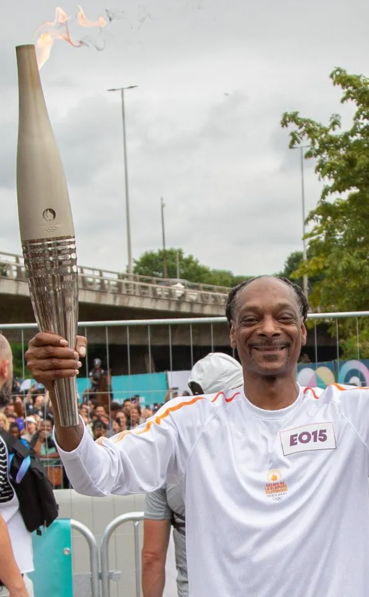
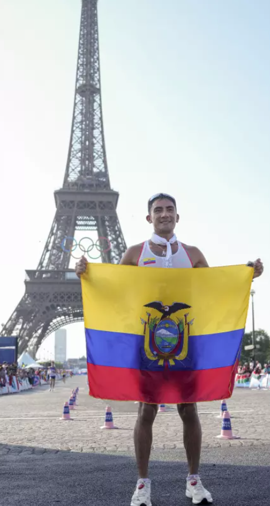
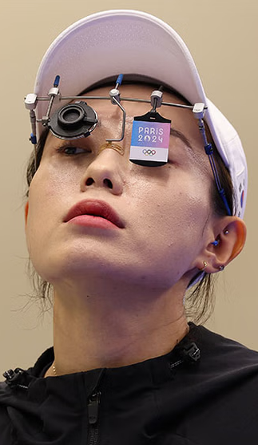

## {}

::: columns
::: {.column width="37.5%"}
{style="margin-left:-60px"}
:::

::: {.column width="60%"}
::: {.title data-id="title"}
Módulo 3: Introducción al análisis de varianza
:::

Mauricio Moreno, PhD

Domingo 29 de noviembre de 2026
:::
:::

{.image-left}

## Hoy

1.  ¿Por qué no hacer muchas pruebas t?
2.  La idea del ANOVA y el ANOVA de una vía en R
3.  Supuestos y diagnósticos
4.  Comparaciones múltiples
5.  Cuando los supuestos fallan: transformaciones y Kruskal-Wallis

## Los datos de hoy {.smaller}

Usamos la tabla `ranas` del [Módulo 1](modulo-1.html), con los tratamientos como **factores**.

```{r}
#| code-fold: true
ranas <- read.csv("datos/ranas.csv")
ranas$Pred  <- factor(ranas$Pred)
ranas$Res   <- factor(ranas$Res)
ranas$Hatch <- factor(ranas$Hatch)
str(ranas)
```

# ANOVA de una vía

## Una pregunta, tres grupos {.smaller}

¿Cambia la masa de los renacuajos al salir del agua según el depredador?

```{r}
#| fig-height: 4.2
boxplot(Mass.final ~ Pred, data = ranas, xlab = "Depredador", ylab = "Masa final (g)")
```

::: callout-tip
**Graficar antes de modelar:** ¿qué observas?
:::

## ¿Por qué no tres pruebas t? {.smaller}

::: incremental
-   Con tres grupos hay tres pares: `C`-`L`, `C`-`NL` y `L`-`NL`.
-   Cada prueba con $\alpha = 0.05$ tiene un 5% de riesgo de un falso positivo.
-   Con tres pruebas, el riesgo de **al menos un** falso positivo es $1 - 0.95^3 \approx 0.14$.
-   Con 10 grupos (45 pares), sería casi del 90%.
-   El **ANOVA** compara todos los grupos a la vez, con una sola prueba.
:::

## La idea del ANOVA {.smaller}

$H_0: \mu_C = \mu_L = \mu_{NL}$ frente a $H_1$: al menos una media es distinta.

. . .

::: incremental
-   La variación total de los datos se divide en dos partes:
    -   variación **entre** los grupos: cuánto se alejan las medias de los grupos de la media general;
    -   variación **dentro** de los grupos: cuánto se alejan los datos de la media de su grupo.
-   El estadístico $F$ las compara:
:::

. . .

$$
F = \frac{CM_{entre}}{CM_{dentro}}
$$

Si $H_0$ es verdadera, $F \approx 1$. Un $F$ grande indica que las medias difieren más de lo esperado por azar.

## ANOVA de una vía en R {.smaller}

```{r}
modelo <- aov(Mass.final ~ Pred, data = ranas)
summary(modelo)
```

. . .

::: incremental
-   `Df`: grados de libertad. Factor: $k - 1 = 2$; residuales: $n - k = 75$.
-   `Sum Sq` y `Mean Sq`: sumas de cuadrados y cuadrados medios ($CM = SC / gl$).
-   `F value` y `Pr(>F)`: el estadístico $F$ y su valor p.
:::

## {}

::: columns
::: {.column width="37.5%"}
:::

::: {.column width="60%"}
::: {.title data-id="title"}
[Ejercicios, Parte 1](../ejercicios-3.html#parte-1){target="_blank"}
:::

::: {.timer #Timer1 seconds=600 starton=interaction}
:::
:::
:::

{.image-left}

# Supuestos y diagnósticos

## Supuestos del ANOVA {.smaller}

::: incremental
1.  Observaciones **independientes** (depende del diseño del experimento).
2.  **Residuos normales**: los residuos son cada observación menos la media de su grupo.
3.  **Varianzas homogéneas** entre los grupos.
:::

. . .

::: callout-important
La normalidad se revisa sobre los **residuos** del modelo, no sobre la respuesta completa.
:::

## Gráficos de diagnóstico {.smaller}

```{r}
#| fig-height: 5.2
#| fig-width: 11
par(mfrow = c(1, 2))
plot(modelo, which = 1:2)
```

Residuos frente a ajustados: ¿la dispersión es parecida en cada columna? Q-Q: ¿los puntos siguen la línea?

## Pruebas formales {.smaller}

```{r}
shapiro.test(residuals(modelo))
bartlett.test(Mass.final ~ Pred, data = ranas)
```

. . .

::: callout-tip
Si los supuestos fallan: transformar la respuesta (por ejemplo, con `log()`), o usar una prueba que no los necesite, como **Kruskal-Wallis**.
:::

## {}

::: columns
::: {.column width="37.5%"}
:::

::: {.column width="60%"}
::: {.title data-id="title"}
[Ejercicios, Parte 2](../ejercicios-3.html#parte-2){target="_blank"}
:::

::: {.timer #Timer2 seconds=600 starton=interaction}
:::
:::
:::

{.image-left}

# Comparaciones múltiples

## ¿Qué grupos difieren? {.smaller}

El ANOVA dice que *al menos una* media difiere. La prueba **HSD de Tukey** compara todos los pares y ajusta los valores p.

```{r}
TukeyHSD(modelo)
```

## Tukey en un gráfico {.smaller}

```{r}
#| fig-height: 4.8
plot(TukeyHSD(modelo))
```

Un intervalo que **no contiene el cero** indica una diferencia entre ese par de grupos.

# Cuando los supuestos fallan

## Cuando los supuestos fallan {.smaller}

Datos `InsectSprays`, incluidos en R: número de insectos tras aplicar seis insecticidas.

```{r}
#| fig-height: 3.6
boxplot(count ~ spray, data = InsectSprays, xlab = "Insecticida", ylab = "Insectos")
```

```{r}
modelo_insectos <- aov(count ~ spray, data = InsectSprays)
shapiro.test(residuals(modelo_insectos))$p.value
bartlett.test(count ~ spray, data = InsectSprays)$p.value
```

## Opción 1: transformar la respuesta {.smaller}

En los conteos, la varianza crece con la media. La **raíz cuadrada** suele estabilizarla.

```{r}
modelo_raiz <- aov(sqrt(count) ~ spray, data = InsectSprays)
shapiro.test(residuals(modelo_raiz))$p.value
bartlett.test(sqrt(count) ~ spray, data = InsectSprays)$p.value
summary(modelo_raiz)
```

## Opción 1: transformar la respuesta {visibility="uncounted" .smaller}

```{r}
#| code-fold: true
#| fig-height: 4.6
#| fig-width: 11
par(mfrow = c(1, 2))
plot(modelo_insectos, which = 1, main = "conteo")
plot(modelo_raiz, which = 1, main = "sqrt(conteo)")
```

::: incremental
-   Después de transformar, **siempre** hay que volver a revisar los diagnósticos.
-   Tukey sobre el modelo transformado compara las medias en la escala transformada.
:::

## Opción 2: Kruskal-Wallis {.smaller}

La alternativa no paramétrica al ANOVA de una vía: compara **rangos**. Útil cuando ninguna transformación funciona, o si prefieres no transformar.

```{r}
kruskal.test(count ~ spray, data = InsectSprays)
```

. . .

Y las comparaciones por pares, con valores p ajustados (método de Holm):

```{r}
pairwise.wilcox.test(InsectSprays$count, InsectSprays$spray, exact = FALSE)
```

## {}

::: columns
::: {.column width="37.5%"}
:::

::: {.column width="60%"}
::: {.title data-id="title"}
[Ejercicios, Parte 3](../ejercicios-3.html#parte-3){target="_blank"}
:::

::: {.timer #Timer3 seconds=900 starton=interaction}
:::
:::
:::

{.image-left}

## El camino del ANOVA

1.  **Graficar** los datos por grupo.
2.  **Ajustar** el modelo: `aov(y ~ grupo)`.
3.  **Diagnosticar**: residuos normales y varianzas homogéneas.
4.  Si fallan: **transformar** (`log()`, `sqrt()`) y volver a diagnosticar, o usar **Kruskal-Wallis**.
5.  **Comparar** los grupos: Tukey (o Wilcoxon por pares).
6.  **Resumir** en una frase: qué grupos difieren, cuánto y con qué incertidumbre.

## Antes del próximo domingo {.smaller}

::: incremental
1.  Completa **todos** los [ejercicios](../ejercicios-3.html){target="_blank"} del Módulo 3: lo que no alcanzamos en clase, incluida la Parte 4, es tarea.
2.  Con tus propios datos (o con otra variable de `ranas`), recorre el camino del ANOVA y escribe dos frases con el resultado.
3.  Haz la [autoevaluación](../autoevaluacion-3.html){target="_blank"} del Módulo 3.
:::

## {}

::: columns
::: {.column width="60%"}
::: {.title data-id="title"}
Fin del módulo 3
:::

::: callout-tip
## Créditos de fotos

Portada por <a href="https://unsplash.com/@patwhelen?utm_content=creditCopyText&utm_medium=referral&utm_source=unsplash">Pat Whelen</a> en <a href="https://unsplash.com/photos/train-rail-near-brown-building-during-daytime-yRvYmE7WVec?utm_content=creditCopyText&utm_medium=referral&utm_source=unsplash">Unsplash</a>

Foto final por <a href="https://unsplash.com/@cleipelt?utm_content=creditCopyText&utm_medium=referral&utm_source=unsplash">Chris Leipelt</a> en <a href="https://unsplash.com/photos/rock-formation-on-the-sea-bOHg3NmtWgE?utm_content=creditCopyText&utm_medium=referral&utm_source=unsplash">Unsplash</a>

Resto de fotos: varias fuentes
:::
:::

::: {.column width="37.5%"}
{style="margin-left:120px"}
:::
:::

{.image-right}
