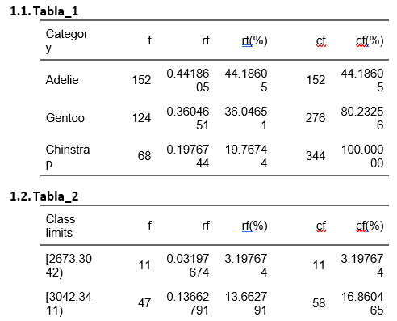
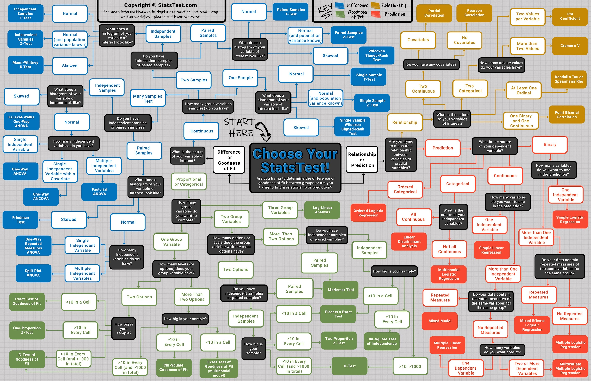

## {}

::: columns
::: {.column width="37.5%"}
{style="margin-left:-60px"}
:::

::: {.column width="60%"}
::: {.title data-id="title"}
Módulo 4: ANOVA de múltiples vías y exportación de resultados
:::

Mauricio Moreno, PhD

Domingo 6 de diciembre de 2026
:::
:::

{.image-left}

## Hoy

1.  ANOVA aditivo de dos vías
2.  Interacciones y ANOVA no aditivo de dos vías
3.  Diagnósticos y transformaciones
4.  Exportar resultados a csv, Excel y Word
5.  Cierre del curso, examen y certificado

## Los datos de hoy {.smaller}

Usamos la tabla `ranas` del [Módulo 1](modulo-1.html), con los tratamientos como **factores**.

```{r}
#| code-fold: true
ranas <- read.csv("datos/ranas.csv")
ranas$Pred  <- factor(ranas$Pred)
ranas$Res   <- factor(ranas$Res)
ranas$Hatch <- factor(ranas$Hatch)
str(ranas)
```

## Un segundo ejemplo {.smaller}

Datos `ToothGrowth`, incluidos en R: crecimiento de los odontoblastos de 60 cobayos según el suplemento de vitamina C y la dosis. Convertimos la dosis en factor.

```{r}
#| code-fold: true
dientes <- ToothGrowth
dientes$dosis <- factor(dientes$dose)
str(dientes)
```

# ANOVA aditivo de dos vías

## Dos factores a la vez {.smaller}

¿Depende la longitud final del depredador, de los recursos, o de ambos?

```{r}
#| fig-height: 4.2
#| fig-width: 11
boxplot(SVL.final ~ Pred + Res, data = ranas, xlab = "Depredador.Recursos", ylab = "Longitud final (mm)")
```

::: incremental
-   ¿Por qué no dos ANOVAs separados? Porque cada factor explica parte de la variación: incluirlos juntos **reduce el error** y prueba cada uno teniendo en cuenta el otro.
:::

## ANOVA aditivo en R {.smaller}

En un modelo **aditivo**, cada factor tiene su propio efecto y los efectos **se suman**: `y ~ A + B`.

```{r}
aditivo <- aov(SVL.final ~ Pred + Res, data = ranas)
summary(aditivo)
```

. . .

::: incremental
-   Cada fila prueba un factor. Aquí: efecto claro del depredador; el de los recursos no llega a ser significativo.
-   Las comparaciones múltiples, factor por factor: `TukeyHSD(aditivo, which = "Pred")`.
:::

# Interacciones

## ¿Qué observas? {.smaller}

```{r}
#| fig-height: 4.6
interaction.plot(x.factor = ranas$Pred, trace.factor = ranas$Res, response = ranas$SVL.final,
                 xlab = "Depredador", ylab = "Longitud final (mm)", trace.label = "Recursos")
```

Líneas **paralelas**: el efecto de los recursos es el mismo con cualquier depredador. No hay interacción.

## Una interacción {.smaller}

Datos `ToothGrowth`, incluidos en R: crecimiento de los odontoblastos de cobayos según el suplemento (`OJ` jugo de naranja, `VC` ácido ascórbico) y la dosis de vitamina C.

```{r}
#| fig-height: 4.2
interaction.plot(x.factor = dientes$dosis, trace.factor = dientes$supp, response = dientes$len,
                 xlab = "Dosis (mg/día)", ylab = "Longitud", trace.label = "Suplemento")
```

Las líneas **se juntan**: la ventaja del jugo de naranja depende de la dosis.

## ANOVA no aditivo en R {.smaller}

`A * B` es una abreviatura de `A + B + A:B`, donde `A:B` es la **interacción**.

```{r}
no_aditivo <- aov(len ~ supp * dosis, data = dientes)
summary(no_aditivo)
```

. . .

::: callout-important
Si la interacción es significativa, no se puede hablar del efecto de un factor **sin decir en qué nivel del otro**.
:::

## Comparaciones con interacción {.smaller}

Para comparar las combinaciones, Tukey sobre el término de la interacción (aquí, solo las seis primeras de 15 comparaciones):

```{r}
head(TukeyHSD(no_aditivo, which = "supp:dosis")$`supp:dosis`)
```

# Diagnósticos y transformaciones

## Los mismos supuestos {.smaller}

```{r}
#| fig-height: 4.2
#| fig-width: 11
par(mfrow = c(1, 2))
plot(no_aditivo, which = 1:2)
```

```{r}
shapiro.test(residuals(no_aditivo))$p.value
bartlett.test(len ~ interaction(supp, dosis), data = dientes)$p.value
```

## Cuando la variación crece con la media {.smaller}

::: incremental
-   Un **embudo** en el gráfico de residuos frente a ajustados (la dispersión crece con la media) es típico de tiempos, conteos y masas.
-   El **logaritmo** suele estabilizar la varianza: `aov(log(y) ~ A * B)`.
-   En escala logarítmica, los efectos se **multiplican**. A veces una interacción en la escala original **desaparece** en la escala logarítmica.
-   Lo veremos con los datos de las ranas en los ejercicios.
:::

. . .

::: callout-tip
**Moraleja:** revisa los diagnósticos **antes** de interpretar una interacción.
:::

## {}

::: columns
::: {.column width="37.5%"}
:::

::: {.column width="60%"}
::: {.title data-id="title"}
[Ejercicios, Partes 1 y 2](../ejercicios-4.html#parte-1){target="_blank"}
:::

::: {.timer #Timer1 seconds=1500 starton=interaction}
:::
:::
:::

{.image-left}

# Exportar resultados

## La tabla del ANOVA como tabla de datos {.smaller}

```{r}
tabla_anova <- as.data.frame(summary(aditivo)[[1]])
tabla_anova <- cbind(Fuente = rownames(tabla_anova), tabla_anova)
tabla_anova
```

## csv y Excel {.smaller}

```{r}
#| eval: false
write.csv(tabla_anova, "resultados/tabla_anova.csv", row.names = FALSE)
```

. . .

Varias tablas en un mismo archivo de Excel, una por hoja:

```{r}
#| eval: false
library(writexl)
medias <- aggregate(SVL.final ~ Pred + Res, data = ranas, FUN = mean)
write_xlsx(list(anova = tabla_anova, medias = medias),
           path = "resultados/resultados_longitud.xlsx")
```

## Word {.smaller}

::: columns
::: {.column width="55%"}
```{r}
#| eval: false
library(flextable)

tabla_word <- flextable(tabla_anova)
tabla_word <- colformat_double(tabla_word, digits = 3)
tabla_word <- autofit(tabla_word)

save_as_docx(tabla_word, path = "resultados/tabla_anova.docx")
```

::: incremental
-   La tabla llega a Word como una **tabla editable**, no como imagen.
-   Los valores p muy pequeños: escríbelos como $p < 0.001$.
:::
:::

::: {.column width="45%"}
{fig-align="center"}
:::
:::

## {}

::: columns
::: {.column width="37.5%"}
:::

::: {.column width="60%"}
::: {.title data-id="title"}
[Ejercicios, Parte 3](../ejercicios-4.html#parte-3){target="_blank"}
:::

::: {.timer #Timer2 seconds=900 starton=interaction}
:::
:::
:::

{.image-left}

# Cierre del curso

## Lo que vimos en cuatro domingos {.smaller}

| Módulo | Preguntas que ya puedes responder con R |
|:--|:--|
| 1 | ¿Cómo son mis datos? Importar, resumir y graficar. |
| 2 | ¿Es esta media distinta de un valor? ¿Difieren dos grupos? ¿Cambiaron los mismos individuos? |
| 3 | ¿Difieren tres o más grupos? ¿Cuáles? |
| 4 | ¿Cómo actúan dos factores a la vez? ¿Cómo llevo los resultados a un informe? |

## Antes de terminar...

{fig-align="center" width=900}

::: footer
[statstest.com](https://www.statstest.com/){target="_blank"}
:::

## Examen y certificado {.smaller}

::: incremental
-   El **examen virtual** estará disponible a partir del día 7 de diciembre; la fecha límite se anuncia en clase. Vale el **60%** de la nota.
-   Es un **script de R para completar**: llenas los espacios en blanco, ejecutas todo con "Source" y entregas el archivo `.R`.
-   Los ejercicios en clase valen el **40%**.
-   Con **7/10** obtienes el certificado de aprobación; si no, el de asistencia.
-   Antes del examen, completa **todos** los [ejercicios](../ejercicios-4.html){target="_blank"} del Módulo 4 (incluida la Parte 4) y repasa las [autoevaluaciones](../autoevaluacion-1.html){target="_blank"} de los cuatro módulos.
-   ¿Quieres seguir? El curso **Visualización de datos en R** cubre `{tidyverse}`, `{ggplot2}` y reportes con Quarto.
:::

## {}

::: columns
::: {.column width="60%"}
::: {.title data-id="title"}
¡Gracias!
:::

::: callout-tip
## Créditos de fotos

Portada por <a href="https://unsplash.com/@becomes?utm_content=creditCopyText&utm_medium=referral&utm_source=unsplash">Becomes Co</a> en <a href="https://unsplash.com/photos/2-men-sitting-on-black-office-rolling-chairs-s_FHDDSVp1s?utm_content=creditCopyText&utm_medium=referral&utm_source=unsplash">Unsplash</a>

Foto final por <a href="https://unsplash.com/@wolfgang_hasselmann?utm_content=creditCopyText&utm_medium=referral&utm_source=unsplash">Wolfgang Hasselmann</a> en <a href="https://unsplash.com/photos/dandelion-flower-under-golden-hour-Kovuf0yU8NU?utm_content=creditCopyText&utm_medium=referral&utm_source=unsplash">Unsplash</a>

Resto de fotos: varias fuentes
:::
:::

::: {.column width="37.5%"}
{style="margin-left:120px"}
:::
:::

{.image-right}
